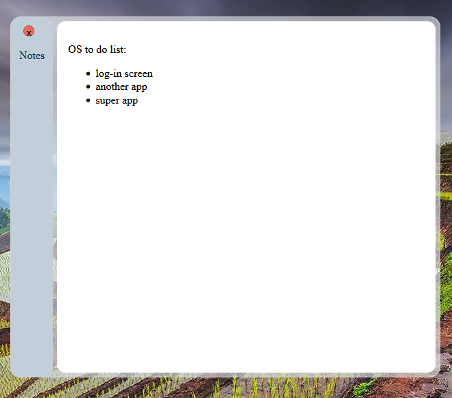
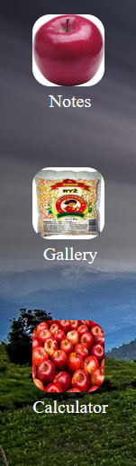
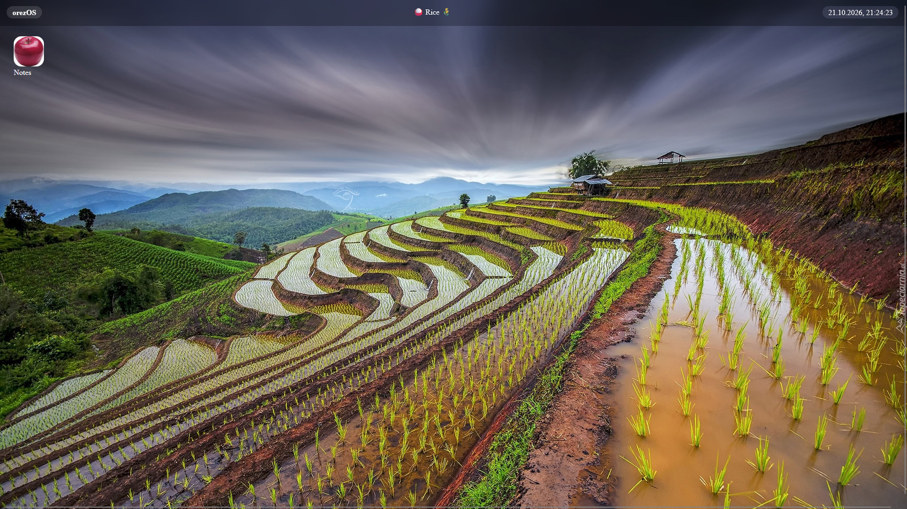

## WebOS , orezOS
*My attempt at creating my own web OS.*

You can essentially just open the 'notes' app, move it around and close it.
It is not finished, yet. I will keep on updating though.

## why build a webOS

I started building it to learn a bit of coding.Quickly found out that i don't understand many things.
Now i think i just do it for fun(if i already have an idea of what to do) otherwise i learn, but that can be fun too.

## Features

- Desktop-style interface
- Draggable and interactive windows
- Runs directly in the browser

## How does it look

 

## Lenguages

  - HTML
  - CSS
  - Javascript

